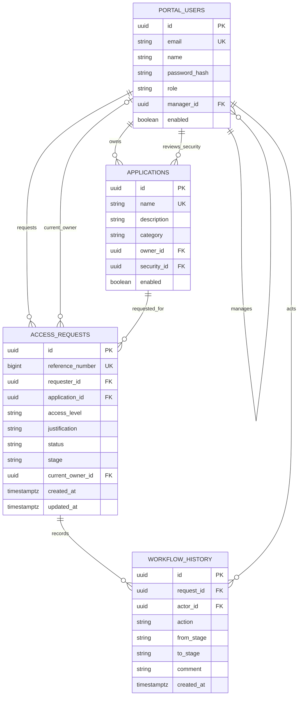

# Database and service design

Flyway owns schema creation. Foreign keys prevent orphaned assignments, requests, and actions. Check constraints restrict role, access level, action, status, and stage values. A terminal-state constraint requires completed requests to have no current owner and active requests to retain an owner. Indexes support requester lists, approval queues, and request history.

`ApiController` validates HTTP inputs and resolves the signed-in account. `WorkflowService` owns route selection, participant visibility, transitions, and audit writes. `SecurityConfig` handles password verification, sessions, CSRF, and unauthenticated responses. The frontend never chooses an approver or sends a requester ID: both are resolved on the server.

For each transition, the service obtains a row lock, reloads the current state, validates ownership and the action, updates status/stage/owner, and inserts a history row. A single transaction commits both writes. This prevents duplicate concurrent approvals and partial workflow changes. Client-provided stages, owners, and statuses are never accepted.

Roles are stored per account for this onboarding project. Assignments come from the employee's manager relationship and the application's owner/security reviewer. Route configuration must identify active reviewers with the expected roles. User and application administration can later be added behind explicit administrative authorization; no such mutation endpoints are exposed today.
